&nbsp;&nbsp;&nbsp;&nbsp;

  

Final-year Electrical &amp; Computer Engineering student at Amrita Vishwa Vidyapeetham, Coimbatore. 
I build intelligence that respects physics — from governing equations to models that run on real hardware. 
IEEE EPREC 2026 (published) &nbsp;·&nbsp; IEEE SPICES 2026 (accepted)

<b>Larsen &amp; Toubro</b> &nbsp;·&nbsp; industry internship, 2026 
EV powertrain simulation · PMSM / BLDC motor control · DC-DC converters · BMS architecture · CAN · railway SCADA modelling

<b>AWS Academy</b> &nbsp;·&nbsp; cloud foundations, 2026 
cloud architecture · compute &amp; storage · networking · security

open to research collaborations &nbsp;·&nbsp; ML roles &nbsp;·&nbsp; data engineering challenges

