

<picture><source media="(prefers-color-scheme: dark)" srcset="assets/dark/hero.svg"></picture>

<picture><source media="(prefers-color-scheme: dark)" srcset="assets/dark/marquee.svg"></picture>

<picture><source media="(prefers-color-scheme: dark)" srcset="assets/dark/sec01.svg"></picture>

I'm an **Electrical & Computer Engineering undergraduate at Amrita Vishwa Vidyapeetham, Coimbatore**, working where **mathematics, algorithms, physical principles and hardware converge** — from hyperspectral biometrics and physics-informed neural networks to federated learning, data pipelines and intelligent power systems.

<picture><source media="(prefers-color-scheme: dark)" srcset="assets/dark/metrics.svg">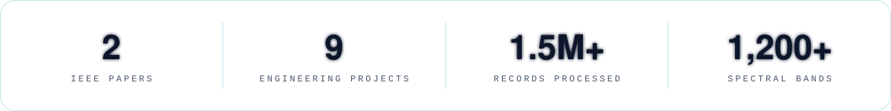</picture>

<picture><source media="(prefers-color-scheme: dark)" srcset="assets/dark/sec02.svg"></picture>

<a href="https://doi.org/10.1109/EPREC66546.2026.11412040"><picture><source media="(prefers-color-scheme: dark)" srcset="assets/dark/pub1.svg"></picture></a>
<picture><source media="(prefers-color-scheme: dark)" srcset="assets/dark/pub2.svg"></picture>

<picture><source media="(prefers-color-scheme: dark)" srcset="assets/dark/sec03.svg"></picture>

<a href="https://github.com/niranjan-crypt/CommerceIQ"><picture><source media="(prefers-color-scheme: dark)" srcset="assets/dark/proj1.svg"></picture></a>
<a href="https://github.com/niranjan-crypt/Privacy-Preserving-Federated-Learning-FL-System-for-Text-Prediction"><picture><source media="(prefers-color-scheme: dark)" srcset="assets/dark/proj2.svg"></picture></a>
<a href="https://github.com/niranjan-crypt/Hyperspectral-Face-Identification-XAI"><picture><source media="(prefers-color-scheme: dark)" srcset="assets/dark/proj3.svg"></picture></a>
<a href="https://github.com/niranjan-crypt/IntelliPQ-AI-Based-Power-Quality-Monitoring-Fault-Detection"><picture><source media="(prefers-color-scheme: dark)" srcset="assets/dark/proj4.svg"></picture></a>
<a href="https://github.com/niranjan-crypt/Hybrid-Computer-Vision-and-Deep-Learning-for-Automated-Power-Transmission-Fault-Detection"><picture><source media="(prefers-color-scheme: dark)" srcset="assets/dark/proj5.svg"></picture></a>
<picture><source media="(prefers-color-scheme: dark)" srcset="assets/dark/proj6.svg"></picture>
<picture><source media="(prefers-color-scheme: dark)" srcset="assets/dark/proj7.svg"></picture>
<picture><source media="(prefers-color-scheme: dark)" srcset="assets/dark/proj8.svg"></picture>
<picture><source media="(prefers-color-scheme: dark)" srcset="assets/dark/proj9.svg"></picture>

<picture><source media="(prefers-color-scheme: dark)" srcset="assets/dark/sec04.svg"></picture>

| | Role | Highlights |
|---|---|---|
| 🚆 **Larsen & Toubro** · 2026 | Industry Internship, Electrical & Transportation | EV powertrain simulation · PMSM / BLDC control · DC-DC converters · BMS architecture · CAN · Railway SCADA modelling |
| ☁️ **AWS Academy** · Feb 2026 | Cloud Foundations | Cloud architecture · compute & storage · networking · security |

<picture><source media="(prefers-color-scheme: dark)" srcset="assets/dark/sec05.svg"></picture>

<picture><source media="(prefers-color-scheme: dark)" srcset="assets/dark/sec06.svg"></picture>

<!-- 3D contribution city: generated by .github/workflows/3d-contrib.yml -->

<!-- Snake: generated by .github/workflows/snake.yml -->

<!-- DEMO REEL: drag an .mp4 (Streamlit dashboard, KinoSync twin, Grad-CAM++) into a GitHub issue comment,
copy the generated https://github.com/user-attachments/... link, and paste it on its own line here.
Or use a GIF:  -->

<picture><source media="(prefers-color-scheme: dark)" srcset="assets/dark/sec07.svg"></picture>

Open to research collaborations, ML roles, data engineering challenges and interdisciplinary engineering projects.

<picture><source media="(prefers-color-scheme: dark)" srcset="assets/dark/footer.svg"></picture>

