<a href="https://github.com/niranjan-crypt/niranjan-crypt.github.io">portfolio</a> &nbsp;·&nbsp; <a href="https://github.com/niranjan-crypt?tab=repositories">repositories</a> &nbsp;·&nbsp; <a href="https://doi.org/10.1109/EPREC66546.2026.11412040">ieee paper</a> &nbsp;·&nbsp; <a href="https://www.linkedin.com/in/YOUR-LINKEDIN-ID">linkedin</a>

  

I study Electrical &amp; Computer Engineering at Amrita Vishwa Vidyapeetham, Coimbatore. 
I work where physics, mathematics and learning systems meet — 
turning the governing equations of a system into models that run on real hardware.

<b>Larsen &amp; Toubro</b> · industry internship, 2026 
EV powertrain simulation · PMSM / BLDC control · BMS architecture · CAN · railway SCADA modelling

<b>AWS Academy</b> · cloud foundations, 2026

python · c++ · c · matlab · simulink · sql · bash · dart 
pytorch · tensorflow · opencv · scikit-learn · flower 
postgresql · docker · streamlit · aws · git · linux · flutter 
esp32 · stm32 · raspberry pi · ble · embedded c

