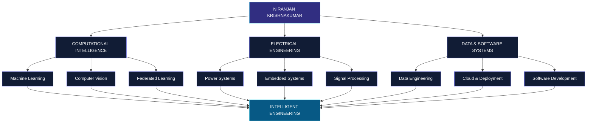

<!-- ============================================================ -->
<!-- NIRANJAN KRISHNAKUMAR | ENGINEERING INTELLIGENCE INTERFACE    -->
<!-- ============================================================ -->

<!-- ========================= HERO ============================== -->

<div align="center">


<br/>


<br/><br/>

<a href="https://github.com/niranjan-crypt">

</a>


<br/><br/>

<a href="https://github.com/niranjan-crypt/niranjan-crypt.github.io">

</a>
<a href="https://github.com/niranjan-crypt?tab=repositories">

</a>

<br/><br/>

<sub>COIMBATORE, INDIA · ELECTRICAL & COMPUTER ENGINEERING · B.TECH 2027</sub>

</div>

---

<!-- ===================== SYSTEM INITIALIZATION ================ -->

<div align="center">

### SYSTEM INITIALIZATION


</div>

```text
┌──────────────────────────────────────────────────────────┐
│  NIRANJAN_OS                         ENGINEERING PROFILE │
├──────────────────────────────────────────────────────────┤
│                                                          │
│  IDENTITY       Electrical & Computer Engineering       │
│  SPECIALIZATION AI / ML / Computer Vision / Data         │
│  RESEARCH       Physics-Informed Intelligence           │
│  ENGINEERING    Embedded & Cyber-Physical Systems        │
│  FOCUS          Research · Optimization · Implementation │
│                                                          │
│  SYSTEM STATUS  OPERATIONAL                              │
│                                                          │
└──────────────────────────────────────────────────────────┘
```

---

<!-- ========================= ABOUT ============================= -->

<div align="center">

## 01 / THE ENGINEER

*Where physical systems meet computational intelligence.*

</div>

I am an **Electrical and Computer Engineering undergraduate at Amrita Vishwa Vidyapeetham**, Coimbatore, working at the intersection of artificial intelligence, mathematical optimization, data engineering and embedded systems.

My approach to engineering is interdisciplinary: understand the physical system, formulate its mathematical representation, develop the computational intelligence and translate it into a practical implementation.

My work spans high-dimensional hyperspectral processing, deep learning architectures, physics-informed neural networks, privacy-preserving distributed learning, scalable data pipelines and intelligent electrical systems.

I am particularly interested in engineering systems where **mathematics, algorithms, physical principles and hardware converge.**

```python
class Niranjan:

    education = "B.Tech | Electrical & Computer Engineering"
    university = "Amrita Vishwa Vidyapeetham"
    graduation = 2027

    interests = [
        "Artificial Intelligence",
        "Machine Learning",
        "Computer Vision",
        "Data Engineering",
        "Power Systems",
        "Embedded Intelligence"
    ]

    research = [
        "Physics-Informed Neural Networks",
        "Hyperspectral Biometrics",
        "Federated Learning",
        "Metaheuristic Optimization"
    ]

    philosophy = "Understand the system. Engineer the intelligence."
```

---

<!-- ===================== ENGINEERING ECOSYSTEM ================ -->

<div align="center">

## 02 / ENGINEERING ECOSYSTEM

*One engineering foundation. Multiple computational domains.*

</div>



---

<!-- ======================== PUBLICATIONS ======================= -->

<div align="center">

## 03 / RESEARCH & PUBLICATIONS

*Research-driven engineering. Mathematical foundations. Experimental validation.*

</div>

<table>
<tr>
<td width="50%" valign="top">

### IEEE EPREC 2026

**Hybrid Optimization for Congestion Management in Deregulated Power Systems**

<sub>IEEE Publication</sub>

- Constrained DC-OPF sensitivity framework.
- Orca Optimization Algorithm (OOA).
- Krill Herd Algorithm (KHA).
- Spotted Hyena Optimizer (SHO).
- Tri-hybrid optimization architecture.
- Power-system congestion management.

<br/>

<a href="https://doi.org/10.1109/EPREC66546.2026.11412040">

</a>

</td>
<td width="50%" valign="top">

### IEEE SPICES 2026

**Physics-Informed ANN-Based MPPT with Markov-Chain-Based Dynamic Validation for Photovoltaic Systems**

<sub>Accepted for presentation</sub>

- Semiconductor diode physics-derived features.
- Physics-informed ANN.
- 300-state 2D Markov-chain weather simulator.
- Dynamic photovoltaic validation.
- Reported R² = 0.9994.
- Reported tracking efficiency above 99.5%.

<br/>


</td>
</tr>
</table>

---

<!-- ======================== EXPERIENCE ========================= -->

<div align="center">

## 04 / INDUSTRY EXPERIENCE

*Applying engineering principles beyond the laboratory.*

</div>

### LARSEN & TOUBRO — INDUSTRY INTERNSHIP

<sub>2026 · Electrical and Transportation Engineering</sub>

- EV powertrain simulation and analysis.
- PMSM and BLDC motor-control concepts.
- DC–DC converter operation.
- Battery Management System architecture.
- CAN-based communication.
- Railway SCADA automation modelling.

### AWS ACADEMY — CLOUD FOUNDATIONS

<sub>February 2026</sub>

- Cloud architecture fundamentals.
- Compute and storage services.
- Networking and infrastructure.
- Cloud security fundamentals.

---

<!-- ========================== PROJECTS ========================= -->

<div align="center">

## 05 / SELECTED ENGINEERING PROJECTS

*From mathematical models to intelligent implementations.*

</div>

### 01 — COMMERCEIQ

**END-TO-END E-COMMERCE DATA ENGINEERING & ANALYTICS**

<a href="https://github.com/niranjan-crypt/CommerceIQ">

</a>


- ETL pipeline processing 100,000+ orders and 1.5 million records.
- PostgreSQL transactional database and dimensional warehouse.
- Third Normal Form and Kimball star-schema modelling.
- 22 automated data quality checks.
- SQL cohort retention and RFM segmentation.
- Market basket analysis.
- Query optimization with measured 5.35× speedup.
- Streamlit analytics dashboard.

<details>
<summary><b>TECHNICAL IMPLEMENTATION</b></summary>

| Layer | Implementation |
|---|---|
| Ingestion | Python ETL |
| Storage | PostgreSQL |
| Modelling | 3NF, Star Schema |
| Analytics | SQL, RFM, Cohorts |
| Validation | Data Quality Checks |
| Visualization | Streamlit, Plotly |
| Infrastructure | Docker |

</details>

---

### 02 — PRIVACY-PRESERVING FEDERATED LEARNING

**DISTRIBUTED LSTM-BASED NEXT-WORD PREDICTION**

<a href="https://github.com/niranjan-crypt/Privacy-Preserving-Federated-Learning-FL-System-for-Text-Prediction">

</a>


- Distributed learning across simulated clients.
- Flower federated learning framework.
- FedAvg model aggregation.
- LSTM-based next-word prediction.
- Local data retention.
- CPU, RAM, battery and network-based client eligibility.
- Fernet encryption and PBKDF2-derived keys.

<details>
<summary><b>TECHNICAL IMPLEMENTATION</b></summary>

| Layer | Implementation |
|---|---|
| Framework | Flower |
| Model | LSTM |
| Aggregation | FedAvg |
| Privacy | Local training |
| Security | Fernet, PBKDF2 |
| Monitoring | Resource-aware client selection |

</details>

---

### 03 — HYPERSPECTRAL FACE IDENTIFICATION & XAI

**SPECTRAL-SPATIAL HUMAN IDENTIFICATION**

<a href="https://github.com/niranjan-crypt/Hyperspectral-Face-Identification-XAI">

</a>


- Hyperspectral imaging across 1,200+ bands.
- RGB baseline and hyperspectral research tracks.
- PUMA-based optimal spectral band selection.
- Three-band compact spectral subset exploration.
- Spectral-spatial feature extraction.
- ArcFace-based representation learning.
- SHAP, LIME and Grad-CAM++ explainability.
- INT8 deployment targeting Raspberry Pi 4.

<details>
<summary><b>TECHNICAL IMPLEMENTATION</b></summary>

| Component | Method |
|---|---|
| Input | Hyperspectral data |
| Feature extraction | 3D-CNN |
| Band selection | PUMA optimization |
| Representation | ArcFace |
| Explainability | SHAP, LIME, Grad-CAM++ |
| Deployment target | Raspberry Pi 4 |

</details>

---

### 04 — INTELLIPQ

**AI-BASED POWER QUALITY MONITORING & FAULT DETECTION**

<a href="https://github.com/niranjan-crypt/IntelliPQ-AI-Based-Power-Quality-Monitoring-Fault-Detection">

</a>


- Multi-modal waveform and CSV ingestion.
- FFT, RMS, THD and Crest Factor analysis.
- IEEE 1159 and IEEE 519 rule evaluation.
- 1D-CNN and BiLSTM classification.
- Neuro-symbolic decision arbitration.
- Prescriptive engineering action engine.
- Docker deployment and automated testing.

---

### 05 — POWER TRANSMISSION FAULT DIAGNOSIS

**COMPUTER VISION FOR TRANSMISSION INFRASTRUCTURE INSPECTION**

<a href="https://github.com/niranjan-crypt/Hybrid-Computer-Vision-and-Deep-Learning-for-Automated-Power-Transmission-Fault-Detection">

</a>

- Drone imagery-based fault identification.
- Transfer-learning CNN benchmarking.
- Hough Circle Transform.
- HOG and GLCM feature extraction.
- Classical CV vs deep learning comparison.
- Reported classification accuracy: 82%.

---

### 06 — PHYSICS-INFORMED SOLAR MPPT

**PHYSICS-GUIDED NEURAL MAXIMUM POWER POINT TRACKING**


- Semiconductor diode physics-derived features.
- Physics-informed ANN architecture.
- 45,000-sample dataset.
- 300-state 2D Markov-chain stochastic weather simulation.
- Dynamic environmental validation.
- Reported simulation R² = 0.9994.

---

### 07 — KINOSYNC

**SMART GLOVE & INTERACTIVE 3D DIGITAL TWIN**


- ESP32 sensor acquisition.
- Continuous joint-flexion monitoring.
- BLE 5.0 GATT telemetry.
- Interactive Flutter 3D digital twin.
- PPG pulse monitoring.

---

### 08 — HYBRID PSO-GA MRI SEGMENTATION

**MULTILEVEL OTSU THRESHOLD OPTIMIZATION**

- Hybrid Particle Swarm Optimization and Genetic Algorithm.
- Multilevel Otsu thresholding.
- GLCM texture feature extraction.
- Random Forest validation.

---

### 09 — TOC-AV

**FORMAL SAFETY VERIFICATION FOR AUTONOMOUS VEHICLES**

- Deterministic and Nondeterministic Finite Automata.
- Timed Automata.
- Context-Free Grammars in Chomsky Normal Form.
- Formal collision-free autonomous parking verification.

---

<!-- ======================= TECHNICAL ARSENAL =================== -->

<div align="center">

## 06 / TECHNICAL ARSENAL

*An interdisciplinary toolkit for intelligent engineering.*

<br/>

### 01 — PROGRAMMING LANGUAGES


<sub>Python · C++ · C · MATLAB · Bash · Dart · SQL</sub>

<br/><br/>

### 02 — MACHINE LEARNING & DEEP LEARNING


<sub>ANN · CNN · 1D-CNN · 3D-CNN · BiLSTM · Transfer Learning · Federated Learning · Flower · FedAvg</sub>

<br/><br/>

### 03 — DATA ENGINEERING & ANALYTICS


<br/>


<br/>

<sub>ETL / ELT · Data Cleansing · Data Validation · SQL Optimization · 3NF · Star Schema · RFM · Cohort Analysis · Market Basket Analysis · Docker Compose</sub>

<br/><br/>

### 04 — COMPUTER VISION & EXPLAINABLE AI


<br/>

<sub>Hyperspectral Imaging · Spectral-Spatial Fusion · ArcFace · HOG · GLCM · LBP · Hough Transform · SHAP · LIME · Grad-CAM++</sub>

<br/><br/>

### 05 — SCIENTIFIC COMPUTING & OPTIMIZATION


<br/>

<sub>PSO · GA · OOA · KHA · SHO · PUMA · Markov Chains · Numerical Optimization · Mathematical Modelling</sub>

<br/><br/>

### 06 — EMBEDDED SYSTEMS & HARDWARE


<br/>


<br/>

<sub>GATT · Sensor Acquisition · Embedded C · Firmware · Real-Time Telemetry · Edge AI · Digital Twins · PPG</sub>

<br/><br/>

### 07 — SOFTWARE & CLOUD


<br/>

<sub>Git · GitHub · VS Code · Linux · Flutter · AWS Cloud Foundations · Docker · Docker Compose · CI/CD</sub>

<br/><br/>

### 08 — ELECTRICAL & ENERGY SYSTEMS


<br/>

<sub>Power Systems · DC-OPF · PTDF · MPPT · DSP · FFT · THD · RMS · PMSM · BLDC · BMS · DC-DC Converters · CAN · SCADA</sub>

<br/><br/>


<sub>CONTINUOUS LEARNING · EXPERIMENTATION · ENGINEERING</sub>

</div>

---

<!-- ========================== RESEARCH APPROACH ================ -->

<div align="center">

## 07 / HOW I APPROACH ENGINEERING

*From problem formulation to implementation.*

</div>

```text
01  PROBLEM IDENTIFICATION
    Understand the physical or computational problem.

02  MATHEMATICAL MODELLING
    Establish governing principles and constraints.

03  ALGORITHM DESIGN
    Develop models, architectures and optimization strategies.

04  EXPERIMENTAL VALIDATION
    Benchmark, evaluate and investigate limitations.

05  SYSTEM IMPLEMENTATION
    Integrate software, computation and hardware.

06  PERFORMANCE OPTIMIZATION
    Improve efficiency, reliability and deployment readiness.
```

---

<!-- ========================== CONNECT ========================== -->

<div align="center">


## 08 / BEYOND THE REPOSITORY

<br/>


<br/><br/>

Open to research collaborations, machine learning opportunities, data engineering challenges and interdisciplinary engineering projects.

<br/><br/>

<a href="https://github.com/niranjan-crypt">

</a>

<a href="https://github.com/niranjan-crypt/niranjan-crypt.github.io">

</a>

<a href="https://www.linkedin.com/">

</a>

<br/><br/>

**NIRANJAN KRISHNAKUMAR**

<sub>ELECTRICAL & COMPUTER ENGINEERING · COIMBATORE, INDIA</sub>

<br/><br/>

*"Understand the system. Challenge the assumptions. Engineer the solution."*

<br/><br/>


</div>

<!-- =========================== END ============================== -->
